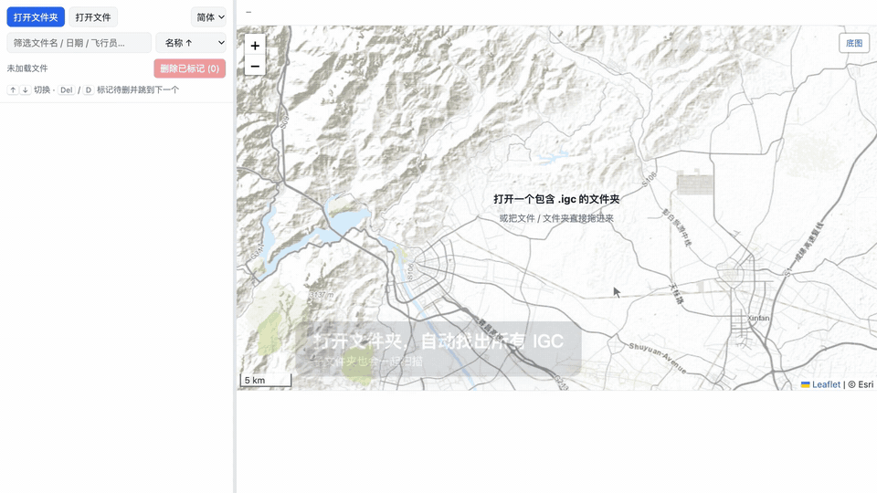

<p align="center"></p>

# 光迹 IGC 查看器 · Lumitrail IGC Viewer

**简体中文** · [繁體中文](README.zh-Hant.md)

> 🌐 **在线使用，不用下载：https://lumitrail.app/tools/igc-viewer/** · [English](https://lumitrail.app/tools/igc-viewer/en/)

滑翔伞（台湾称飛行傘）/ 滑翔机 `.igc` 飞行记录的查看和清理工具：打开文件夹，↑↓ 秒切换看航迹，自动标出 GPS 跳点和疑似接驳车，上传竞赛平台前一键清掉废记录。由 [光迹 Lumitrail](https://lumitrail.app) 提供，免费开源。

A free, open-source viewer for `.igc` flight logs (paragliding / gliding) by [Lumitrail](https://lumitrail.app). Use it online at **https://lumitrail.app/tools/igc-viewer/en/** — open a folder, flip through flights with the arrow keys, spot GPS glitches and shuttle rides, and clean out bad files before uploading to a competition server.



## 使用

**在线**：用电脑上的 **Edge** 或 **Chrome** 打开 https://lumitrail.app/tools/igc-viewer/ ，点「打开文件夹」，选你存 IGC 的文件夹。不用注册。繁體版：https://lumitrail.app/tools/igc-viewer/zh-hant/ ，English：https://lumitrail.app/tools/igc-viewer/en/ 。

**离线**：下载 [`IGC-Viewer.html`](https://github.com/weidays/igc-viewer/releases/latest/download/IGC-Viewer.html)（简体）、[`IGC-Viewer-zh-Hant.html`](https://github.com/weidays/igc-viewer/releases/latest/download/IGC-Viewer-zh-Hant.html)（繁體）或 [`IGC-Viewer-en.html`](https://github.com/weidays/igc-viewer/releases/latest/download/IGC-Viewer-en.html)（English），双击用浏览器打开就行。没网也能看航迹，只是没有地图底图。

**隐私**：IGC 文件只在你自己的电脑上读取，不会上传到任何地方。地图底图会向 Esri 请求图块，因此会透露飞行区域的大致位置；介意的话，在右上角「底图」里选「无底图」。

## 功能

- **打开文件夹**：递归扫描子文件夹里的所有 `.igc`，也可以直接拖进窗口。下次可一键重新打开上次的文件夹。
- **极速切换**：<kbd>↑</kbd> <kbd>↓</kbd> 切换文件，航迹立即显示；后台预读相邻文件，最近 40 个常驻内存。
- **飞行信息**：日期、飞行员、机型、起降时间、时长、航迹长度、离起飞点最远距离、最高高度、爬升、最大爬升 / 下沉率。
- **高度曲线**：与地图联动，鼠标移上去显示时间、高度、升降速度、地速。
- **GPS 跳点检测**：自动找出定位漂移的点，地图上用橙色圈标出，列表里也会提示。
- **疑似接驳车检测**：忘了关记录仪、降落后坐车回去（或在车上就开了记录）的路段，地图上用紫色虚线标出，高度曲线上也会涂成紫色。
- **⚠ 可疑筛选**：打开文件夹后在后台逐个检查所有文件，点「⚠ 可疑」只看有 GPS 跳点或疑似接驳车的记录，上传竞赛平台前快速清理。
- **标记 & 清理**：按 <kbd>Del</kbd> / <kbd>D</kbd> 标记「待删」并跳到下一个，然后一键「移到 `_已删除` 文件夹（可恢复）」或永久删除。
- **筛选排序**：按文件名、日期、飞行员筛选；按名称或日期排序。
- **三种语言**：简体中文、繁體中文、English，各有独立网址，在左上角按钮那一排切换；浏览器语言不一样时会提示切换。繁體用语按台湾习惯（檔案、資料夾…）。文件名、飞行员名等你自己的数据保持原样。
- 底图可切换：Esri 地形 / Esri 卫星 / OpenTopoMap / 无底图。

| 快捷键 | 作用 |
| --- | --- |
| <kbd>↑</kbd> <kbd>↓</kbd> | 上一个 / 下一个文件 |
| <kbd>PgUp</kbd> <kbd>PgDn</kbd> <kbd>Home</kbd> <kbd>End</kbd> | 翻页 / 第一个 / 最后一个 |
| <kbd>Del</kbd> / <kbd>D</kbd> | 标记 / 取消「待删」 |
| <kbd>Ctrl</kbd>+<kbd>F</kbd> | 筛选 |

> 接驳车检测靠速度、爬升和是否盘旋来判断，针对滑翔伞调过参数：不盘旋却持续爬升 6 分钟以上（车上山路），或高度不变、快速移动 3 分钟以上（车走平路）才会标出。山脊上来回飞不会被误判；太短或很慢很绕的车程可能识别不到。滑翔机（固定翼）记录可能误报。

> 删除和「上次文件夹」依赖浏览器的 File System Access API，需要 Edge / Chrome 等 Chromium 内核浏览器。Firefox / Safari 可以浏览，但不能删除。

## 关于光迹 Lumitrail

光迹 Lumitrail 是一个安静的足迹记录 App：自动记下你走过的路，认出滑翔伞、登山等户外活动，并用 3D 回放、导出视频。数据留在你自己的设备上。

- 官网：https://lumitrail.app
- iOS：[App Store 下载](https://apps.apple.com/app/id6784893459)

## 开发

源码在 [`src/template.html`](src/template.html)（简体写成，英文版写在 `L:en` 块里），Leaflet 和图标在构建时内联进去：

```bash
python3 build.py   # 生成 site/（网站用的三语页面 + csp-hashes.txt）和 dist/（三个离线文件）
```

- 繁體：由简体整页转换，对照表是 `src/zh-Hant.json`。
- English：大段内容写在模板的 `L:en` 块里，界面短语在 `src/en.json`。`build.py` 发现有文字没翻译会报错。

改了界面文字或本 README 后，运行下面的命令重新生成繁體对照表和 [`README.zh-Hant.md`](README.zh-Hant.md)（需要 OpenCC，不要直接改繁體 README）：

```bash
pip install opencc && python3 tools/gen_hant.py
```

`samples/` 里有两个测试用的合成航迹。宣传片由 `promo/` 下的脚本录制（Playwright + 本机 Chrome + ffmpeg）：

```bash
cd promo && npm install
node record.mjs lumitrail.app/tools/igc-viewer hans      # 简体版 → out/promo-hans.mp4
node record.mjs lumitrail.app/tools/igc-viewer hant      # 繁體版 → out/promo-hant.mp4
node record.mjs lumitrail.app/tools/igc-viewer/en en     # English → out/promo-en.mp4
```

## 许可

代码采用 MIT 授权。内含 [Leaflet](https://leafletjs.com)（BSD-2-Clause，见 [`src/LEAFLET-LICENSE`](src/LEAFLET-LICENSE)）。地图底图版权归各自提供方所有，Esri 底图按 Esri 条款显示署名。

原作者：[weidays](https://github.com/weidays)。

「光迹」「Lumitrail」名称和图标属于光迹，不在 MIT 授权范围内。如果你 fork 后另外发布，请换成你自己的名称和图标。
