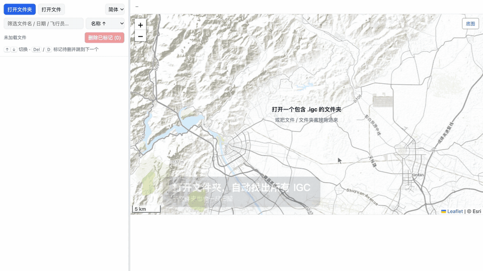

<!-- 本檔由 tools/gen_hant.py 從 README.md 自動產生，請修改 README.md 後重新執行 -->
# IGC Viewer

[简体中文](README.md) · **繁體中文**

一個**單檔案、雙擊即用**的 IGC 飛行記錄檢視器，用來快速瀏覽、篩選和清理飛行傘 / 滑翔機的 `.igc` 航跡檔案。

A single-file, zero-install viewer for `.igc` flight logs (paragliding / gliding). Open a folder, flip through flights with the arrow keys, spot GPS glitches, and clean out bad files.



## 下載使用

1. 下載 [`IGC-Viewer.html`](IGC-Viewer.html)（點進去後點右上角的下載按鈕）。
2. 用 **Edge** 或 **Chrome** 開啟（Windows / macOS / Linux 都可以）。
3. 點「開啟資料夾」，選你存 IGC 的資料夾。

不需要安裝、不需要連網（連網時顯示地圖底圖，沒網也能看航跡）。檔案只在你自己的電腦上讀取，不會上傳到任何地方。

## 功能

- **開啟資料夾**：遞迴掃描子資料夾裡的所有 `.igc`，也可以直接拖進視窗。下次可一鍵重新開啟上次的資料夾。
- **極速切換**：<kbd>↑</kbd> <kbd>↓</kbd> 切換檔案，航跡立即顯示；背景預讀相鄰檔案，最近 40 個常駐記憶體。
- **飛行資訊**：日期、飛行員、機型、起降時間、時長、航跡長度、離起飛點最遠距離、最高高度、爬升、最大爬升 / 下沉率。
- **高度曲線**：與地圖聯動，滑鼠移上去顯示時間、高度、升降速度、地速。
- **GPS 跳點檢測**：自動找出定位漂移的點，地圖上用橙色圈標出，列表裡也會提示。
- **疑似接駁車檢測**：忘了關記錄儀、降落後搭車回去（或在車上就開了記錄）的路段，地圖上用紫色虛線標出，高度曲線上也會塗成紫色。
- **⚠ 可疑篩選**：開啟資料夾後在背景逐個檢查所有檔案，點「⚠ 可疑」只看有 GPS 跳點或疑似接駁車的記錄，上傳競賽平臺前快速清理。
- **標記 & 清理**：按 <kbd>Del</kbd> / <kbd>D</kbd> 標記「待刪」並跳到下一個，然後一鍵「移到 `_已刪除` 資料夾（可恢復）」或永久刪除。
- **篩選排序**：按檔名、日期、飛行員篩選；按名稱或日期排序。
- **簡體 / 繁體**：在左上角按鈕那一排切換；繁體中文系統（台灣、香港、澳門）自動用繁體，用語按台灣習慣（檔案、資料夾…）。檔名、飛行員名等你自己的資料保持原樣。
- 底圖可切換：Esri 地形 / Esri 衛星 / OpenTopoMap / 無底圖。

| 快捷鍵 | 作用 |
| --- | --- |
| <kbd>↑</kbd> <kbd>↓</kbd> | 上一個 / 下一個檔案 |
| <kbd>PgUp</kbd> <kbd>PgDn</kbd> <kbd>Home</kbd> <kbd>End</kbd> | 翻頁 / 第一個 / 最後一個 |
| <kbd>Del</kbd> / <kbd>D</kbd> | 標記 / 取消「待刪」 |
| <kbd>Ctrl</kbd>+<kbd>F</kbd> | 篩選 |

> 接駁車檢測靠速度、爬升和是否盤旋來判斷，針對飛行傘調過參數：不盤旋卻持續爬升 6 分鐘以上（車上山路），或高度不變、快速移動 3 分鐘以上（車走平路）才會標出。山脊上來回飛不會被誤判；太短或很慢很繞的車程可能識別不到。滑翔機（固定翼）記錄可能誤報。

> 刪除和「上次資料夾」依賴瀏覽器的 File System Access API，需要 Edge / Chrome 等 Chromium 核心瀏覽器。Firefox / Safari 可以瀏覽，但不能刪除。

## 開發

原始碼在 [`src/template.html`](src/template.html)，Leaflet 在建置時內嵌進去：

```bash
python3 build.py   # 產生 IGC-Viewer.html
```

改了介面文字或本 README 後，執行下面的命令重新產生繁體對照表 `src/zh-Hant.json` 和 [`README.zh-Hant.md`](README.zh-Hant.md)（需要 OpenCC，不要直接改繁體 README）。`build.py` 發現有介面文字沒有繁體時會提示：

```bash
pip install opencc && python3 tools/gen_hant.py
```

`samples/` 裡有兩個測試用的合成航跡。宣傳片由 `promo/` 下的腳本錄製（Playwright + 本機 Chrome + ffmpeg）：

```bash
cd promo && npm install
node record.mjs github.com/weidays/igc-viewer hans   # 簡體版 → out/promo-hans.mp4
node record.mjs github.com/weidays/igc-viewer hant   # 繁體版 → out/promo-hant.mp4
```

## 授權

MIT。內含 [Leaflet](https://leafletjs.com)（BSD-2-Clause，見 [`src/LEAFLET-LICENSE`](src/LEAFLET-LICENSE)）。地圖底圖版權歸各自提供方所有。
